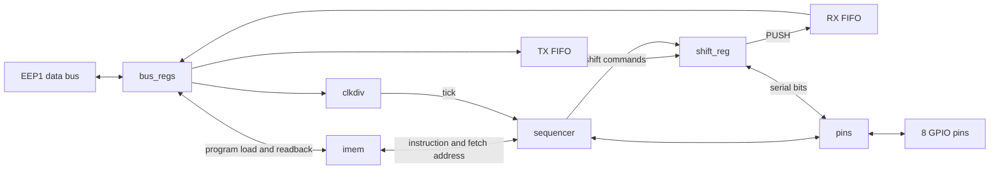

# PIO specification

## EEP1 interface

PIO is designed for memory-mapped `LDR` and `STR` on the EEP1 data bus. The word range is `0xFFE0` to `0xFFFF`. The address decoder would assert `host_valid` for accesses in that range and pass the low five address bits as `host_addr`. `STR` sets `host_write = 1` and supplies `host_wdata`. `LDR` sets `host_write = 0` and reads `host_rdata`. Both data ports are 16 bits by default. Cocotb currently drives the register bus directly.

`bus_regs` accepts one request per rising edge with `host_valid` high. An `IMEM` read returns data after the edge, so the CPU must hold the selection through readback. Other reads return data before the edge. An `RXDATA` read pops one word at that edge.

| Word offset | Register | Access | Purpose |
| --- | --- | --- | --- |
| `0x00` | `CTRL` | R/W | Bit 0 starts (`1`) or stops (`0`) PIO. |
| `0x01` | `STATUS` | R | Bits `[4:0]` are `FAULT`, `RX_EMPTY`, `RX_FULL`, `TX_EMPTY` and `TX_FULL`. |
| `0x02` | `CLKDIV` | R/W | One tick every `CLKDIV + 1` system clocks. |
| `0x03` | `TXDATA` | W | Enqueues one 16-bit word if TX has room. |
| `0x04` | `RXDATA` | R | Returns and removes the oldest RX word. Returns zero when RX is empty. |
| `0x05` | `SIDEPIN` | R/W | Bits `[2:0]` select the side-set pin. |
| `0x10` to `0x1F` | `IMEM[0]` to `IMEM[15]` | R/W | One instruction word per slot. |

While stopped, write `IMEM`, `CLKDIV` and optionally `SIDEPIN`, then set `RUN`. Poll `TX_FULL` before writing `TXDATA` and `RX_EMPTY` before reading `RXDATA`.

## Dataflow

All modules share the system clock. `imem` fetches slot 0 on start and the next slot on each execution edge. Each FIFO holds two words. `OUT` sends the most significant bit first. `IN` shifts sampled bits into the low end of the input register. `pins` synchronises inputs through two flip-flops and stores each pin's output value and enable.

## PIO ISA

| Bits | Field |
| --- | --- |
| `[15:13]` | Opcode |
| `[12:10]` | Extra delay ticks, 0 to 7 |
| `[9]` | Side-set enable |
| `[8]` | Side-set output value |
| `[7:0]` | Opcode-specific operand |

| Opcode | Instruction | Operand and effect |
| --- | --- | --- |
| `000` | `SET` | `[7:6]` selects output value (`00`), output enable (`01`) or `X` (`10`). Pin writes use `[5:3]` for the pin and `[0]` for the value. `X` takes `[4:0]`. |
| `001` | `JMP` | `[3:0]` selects the slot. `[7:6] = 00` always jumps. `01` jumps and decrements `X` if `X` is non-zero. |
| `010` | `WAIT` | Stall until the sampled pin `[3:1]` equals `[0]`. |
| `011` | `IN` | Shift the sampled bit from pin `[2:0]` into the input shift register. |
| `100` | `OUT` | Write the output shift register's top bit to pin `[2:0]` and shift left. |
| `101` | `PUSH` | Copy the input shift register to RX and clear it. Stall if RX is full. |
| `110` | `PULL` | Load the output shift register from TX. Stall if TX is empty. |
| `111` | Reserved | Raises an instruction fault. |